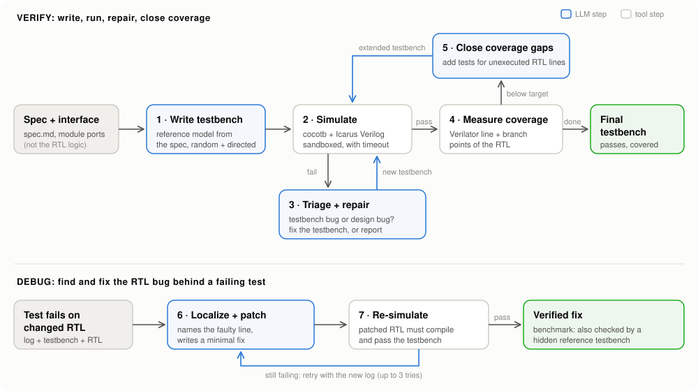
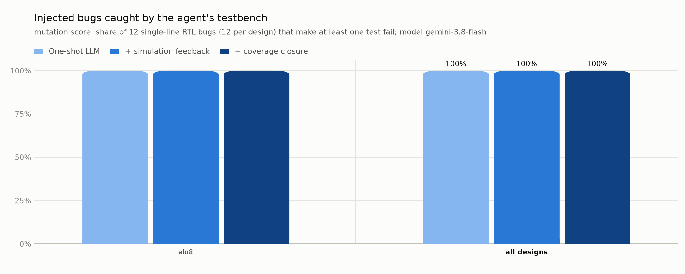

# DVAgent: an AI agent that writes, runs and debugs chip testbenches


DVAgent is an LLM agent for hardware **design verification**. Give it a Verilog design and its written specification, and it:

1. **writes** a self-checking [cocotb](https://www.cocotb.org/) testbench with a Python reference model, from the spec alone,
2. **runs** it in a simulator and **repairs its own mistakes**, deciding each time whether a failure is a testbench bug or a real design bug,
3. **measures RTL code coverage** with Verilator and adds tests until every line and branch is exercised,
4. **debugs**: when an RTL change breaks a test, it names the faulty RTL line and proposes a fix, and re-simulates the fix before reporting it.

It comes with **DVBench**, a benchmark of 10 designs with 120 injected bugs that measures what each step of the loop is worth.



## Results

<!-- results:start -->
<picture>
  <source media="(prefers-color-scheme: dark)" srcset="results/gemini/chart_dark.png">
  
</picture>

Model: `gemini-3.8-flash` via gemini, run 2026-10-19 17:42:35. 1 designs, 12 injected bugs, 1 LLM calls.


| Stage | Testbenches passing on the correct design | Bugs caught | Mean line/branch coverage |
|---|---|---|---|
| One-shot LLM | 1/1 | 12/12 (100.0%) | 100.0% |
| + simulation feedback | 1/1 | 12/12 (100.0%) | 100.0% |
| + coverage closure | 1/1 | 12/12 (100.0%) | 100.0% |

False design-bug reports on correct designs: 0.

### Per design

| Design | Level | Passes (1-shot / final) | Coverage (1-shot / final) | Bugs caught: 1-shot / +feedback / final | Debug: line found / fixed | LLM calls |
|---|---|---|---|---|---|---|
| alu8 | easy | yes (7/7) / yes (7/7) | 100.0% / 100.0% | 12 / 12 / 12 of 12 | 0/0 / 0/0 | 1 |

Full data: [`results/gemini/`](results/gemini) (per-step agent log, every testbench it wrote, every debug attempt, and the complete LLM transcript). The workflow run's artifact holds `report.html`, a browsable report of every step.
<!-- results:end -->

## The benchmark (DVBench)

### Designs

Ten Verilog-2001 designs, each with a datasheet-style spec ([`bench/designs/*/spec.md`](bench/designs)) and a hidden, human-written reference testbench that reaches 100 % line/branch coverage:

| Design | Level | RTL lines | What it is | Candidate bugs | Real bugs | Used |
|---|---|---|---|---|---|---|
| `alu8` | easy | 39 | 8-bit combinational ALU: add, subtract, logic, shifts, signed compare, four flags | 71 | 67 | 12 |
| `updown_counter` | easy | 27 | 8-bit loadable up/down counter with programmable wrap value and terminal-count flag | 30 | 29 | 12 |
| `seq_detector` | easy | 37 | FSM that detects the overlapping serial pattern 1011, with a valid qualifier and a saturating match counter | 20 | 19 | 12 |
| `sync_fifo` | medium | 50 | 8x8 synchronous FIFO, first-word fall-through, push and pop together when full, sticky error flags | 60 | 60 | 12 |
| `rr_arbiter` | medium | 47 | 4-way round-robin arbiter with bus ownership (the owner keeps the grant while it requests) | 49 | 46 | 12 |
| `crc8` | medium | 32 | Byte-per-cycle CRC-8 (polynomial 0x07) engine with restart and byte counter | 28 | 28 | 12 |
| `sat_mac` | medium | 33 | Signed 8x8 multiply-accumulate with a 16-bit saturating accumulator | 41 | 35 | 12 |
| `uart_tx` | hard | 102 | UART transmitter: start bit, 8 data bits LSB first, optional even/odd parity, stop bit, busy/done | 90 | 73 | 12 |
| `spi_master` | hard | 70 | SPI mode-0 master: 8-bit full-duplex transfers, SCLK divider, chip select, done pulse | 86 | 67 | 12 |
| `apb_regs` | hard | 56 | APB3 register block: read-only registers, a wait state on one register, write counter, error responses | 53 | 50 | 12 |
| **total** | | **493** | | **528** | **474** | **120** |

### Bugs

The bugs are made by DVAgent's **mutation engine** ([`dvagent/mutate.py`](dvagent/mutate.py)), which changes one token or statement on one line, the way real RTL bugs look:

| Kind | Example |
|---|---|
| relational | `count >= max_val` becomes `count > max_val` |
| arithmetic | `wr_ptr + 3'd1` becomes `wr_ptr - 3'd1` |
| logical / bitwise | `&&` becomes `\|\|`, `^` becomes `\|` |
| shift | `<<` becomes `>>` |
| constant (off by one) | `3'd7` becomes `3'd6`, `8'h07` becomes `8'h08` |
| inverted condition | `if (load)` becomes `if (!(load))` |
| deleted assignment | `count <= count + 8'd1;` becomes `;` |

It knows Verilog's quirks: `<=` as a non-blocking assignment is never treated as a comparison, unary minus is left alone, loop increments are not touched (no infinite loops), and declarations are skipped. Of 528 candidates, every one compiles in both simulators; **54 are equivalent** (no observable change, for example the reset value of a register that is always loaded before use) and were dropped because the reference testbench cannot catch them. From the 474 real bugs, 12 per design were sampled across bug kinds and frozen in [`bench/mutants/`](bench/mutants), so every run uses the same 120 bugs.

### What is measured

One agent run per design produces three testbench snapshots, which separates what each stage adds:

| Snapshot | Meaning |
|---|---|
| **One-shot LLM** | the agent's first draft, before any simulation (what you get by just asking a chatbot) |
| **+ simulation feedback** | the first draft that passes on the correct design after self-repair |
| **+ coverage closure** | the final testbench after the coverage loop |

For each snapshot: does it pass on the correct design, its RTL line/branch coverage, and its **mutation score** (the share of the 120 bugs that make at least one of its tests fail). Then the agent **debugs** up to 4 bugs per design that its final testbench caught: did it point at the right line on the first try (the line its fix edits; fixes are matched by the line's text because models often miscount line numbers), and is its fix correct?

### Keeping it honest

- When writing tests, the agent sees the **spec and the module's port list only**, never the RTL logic, so its reference model is independent of the implementation.
- The agent never sees the hidden reference testbenches or the bug list.
- Only tests that pass on the correct design count towards the mutation score.
- A debug fix counts as correct only if the **hidden reference testbench** passes on the patched RTL. The agent's own testbench could be fooled by a fix that only hides the symptom.
- In the benchmark the designs are known to be correct. If the agent blames the design while writing tests, a reviewer message rejects the claim and the **false alarm is counted** in the results.

## How the agent works

- **One focused prompt per step.** Every step rebuilds its context: the spec, the interface, the current testbench with line numbers, a condensed failure log and a short history of earlier attempts. There is no ever-growing chat, so prompts stay small and free-tier models work. Prompts are in [`dvagent/prompts.py`](dvagent/prompts.py).
- **Verification know-how in the system prompt**: race-free cocotb timing (drive inputs after the falling edge, check after the rising edge in the read-only phase), a cycle-accurate reference model, bounded waits, reset in every test, constrained random with fixed seeds.
- **Triage before repair.** On a failure the model must first return JSON (`blame`: testbench or design, root cause, evidence), then either a corrected testbench or a bug report.
- **Sandboxed simulation.** Each run is a child process with a wall-clock timeout that kills the whole process group, so a testbench waiting forever cannot hang the agent. The log is condensed to the first full traceback, the assertion message of every other failing test, and the testbench's own log lines before each failure.
- **Real coverage feedback.** DVAgent reads Verilator's raw `coverage.dat` points (statement blocks and if/else branches) and gives the model the source line of every unexecuted point. Verilator 5.0's own lcov export merges all points on a line and hides untaken else-branches, so it is not used.
- **Verified debugging.** The model gets the line-numbered RTL and answers with a JSON patch (full replacement lines). The patch must compile in Icarus and Verilator and pass the testbench; otherwise the new failure goes back to the model, up to 3 tries.
- **Any LLM.** One small HTTP client for every OpenAI-compatible API (Gemini, Groq, OpenRouter, OpenAI, Anthropic, a local Ollama), with rate limiting, retries with back-off, detection of an exhausted daily quota, and a full JSONL transcript of every call. The benchmark is resumable: run it again and it continues where it stopped.

## Run it

### On GitHub (nothing to install)

1. Put an API key in the repository secrets (**Settings → Secrets and variables → Actions**), for example `GEMINI_API_KEY` from [Google AI Studio](https://aistudio.google.com).
2. **Actions → benchmark → Run workflow.** The results appear on the run page and are committed to `results/<run_name>/` (summary, charts, an HTML report and the full LLM transcript).

### On Linux, WSL or GitHub Codespaces

The repository includes a dev container, so a Codespace comes with everything installed. Elsewhere:

```bash
sudo apt install iverilog verilator          # Icarus Verilog 12, Verilator 5
pip install -e .                             # cocotb 1.9.2, matplotlib
export GEMINI_API_KEY=...                    # or GROQ_API_KEY, OPENAI_API_KEY, ...
dvagent check                                # simulators, cocotb, key

dvagent verify bench/designs/uart_tx         # write and refine a testbench -> out/uart_tx/
dvagent inject bench/designs/uart_tx --mutant uart_tx_m001 --out buggy_uart   # copy with a known bug
dvagent debug buggy_uart --tb out/uart_tx/test_uart_tx.py                     # find and fix it
dvagent bench --out results/my_run           # the full benchmark
dvagent bench --provider groq --model openai/gpt-oss-120b --out results/groq
```

To verify your own design, make a folder with `spec.md` and `rtl/<module>.v` and run `dvagent verify <folder>`.

## Tests

`python -m pytest tests` runs 60 tests in about 2 minutes, without an API key:

- every reference testbench passes on its correct design, and every frozen bug compiles and is caught,
- the mutation rules, reply parsing and coverage parsing,
- the HTTP client against a local fake server (retries, rate limits, daily quota),
- the complete agent loops and the benchmark pipeline with a scripted LLM, including resume.

They run on every push in GitHub Actions.

## Repository layout

```
dvagent/      agent.py     testbench loop (write, simulate, triage, repair, coverage) and debug loop
              prompts.py   every prompt
              sim.py       sandboxed cocotb runs, result parsing, log condensation
              coverage.py  Verilator coverage points
              mutate.py    mutation engine (bug injector)
              mutants.py   builds and loads the frozen bug sets
              bench.py     benchmark runner (resumable)
              report.py    summary tables, chart, HTML report
              llm.py       OpenAI-compatible client, offline replay/script/file providers
              cli.py       the dvagent command
bench/        designs/<name>/  spec.md, rtl/, ref/test_ref.py (hidden reference testbench), design.json
              mutants/         the 120 frozen bugs (plus every rejected candidate and why)
tests/        pytest suite
results/      benchmark runs
docs/         diagram
```

## Limitations

- The designs are small (27 to 102 lines) and single-module; real blocks are larger and hierarchical.
- The bugs are single-line mutations. Real bugs can span several lines or be missing logic.
- Coverage is line and branch coverage. Verilator 5.0 does not report expression or FSM-arc coverage.
- The debug step patches single-file designs.
